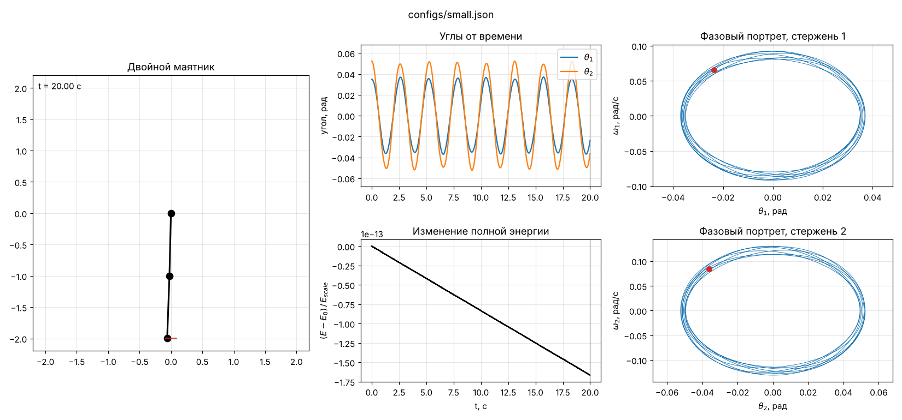
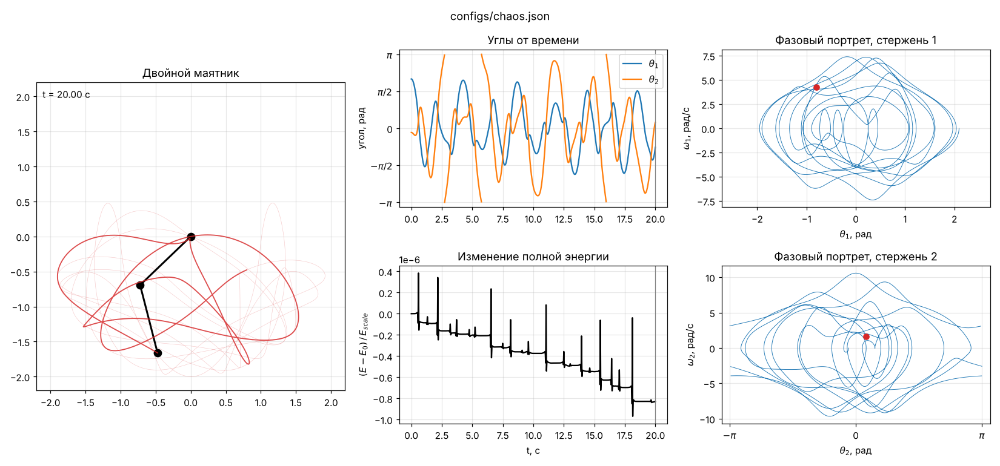
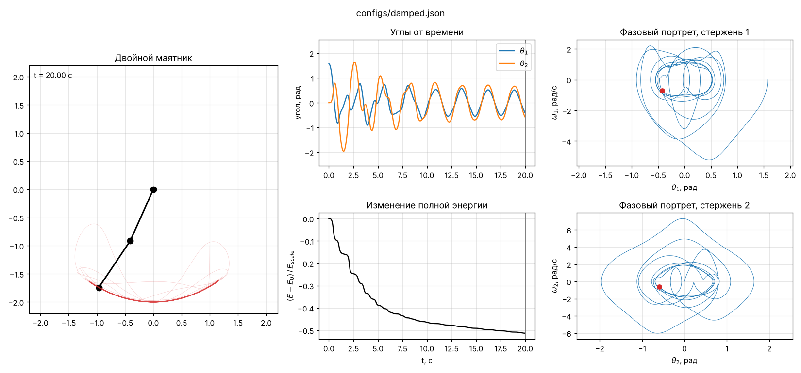
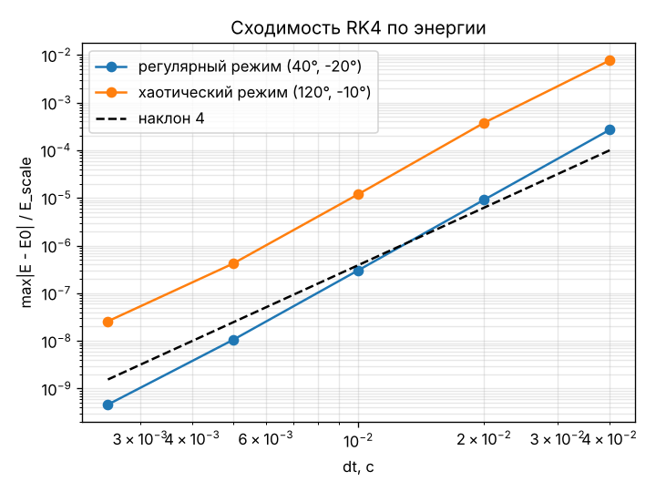

# Двойной маятник: симуляция (этап 1)

Модель двойного маятника по уравнениям Лагранжа с вязким трением (функция Рэлея),
интегратор RK4, визуализация и набор проверок корректности. Дальше на эту основу
будут добавлены момент в точке опоры, линеаризация и LQR.

## Запуск

```bash
pip install -r requirements.txt
python main.py                        # configs/chaos.json: анимация + графики
python main.py configs/small.json     # малые колебания
python main.py configs/damped.json    # затухание с трением
python run_checks.py                  # все проверки (≈10 с)
```

`python main.py <конфиг> --save figures/x.png --no-show` сохраняет картинку без окна.

## Структура

| Файл | Назначение |
|---|---|
| `config.py` | чтение JSON-конфига (никаких параметров в коде нет) |
| `configs/*.json` | m1, m2, L1, L2, g, c1, c2, начальные углы и скорости (в градусах), dt, t_max |
| `physics.py` | `derivatives(state, t, params)`, энергии, мощность трения, линеаризация и нормальные моды |
| `integrator.py` | RK4: `rk4_step(f, y, t, h)`, `integrate(f, y0, t_max, dt)`; принимает только `f(y, t)` и не знает про маятник |
| `visualization.py` | анимация, углы от времени (приведены к [-π, π]), фазовые портреты, энергия |
| `main.py` | запуск симуляции по конфигу и показ результатов |
| `run_checks.py` | проверки корректности |
| `DERIVATION.md` | вывод уравнений в LaTeX: от лагранжиана до системы первого порядка, включая трение |

Интегратор получает правую часть как функцию `f(y, t)`: `make_rhs(params)` из
`physics.py` оборачивает `derivatives`. Момент управления позже подставляется так же,
через замыкание, без правок интегратора. Углы интегрируются без приведения, к
диапазону [-π, π] они приводятся только при построении графиков.

## Проверки (`run_checks.py`)

Все 17 проверок проходят.

| Проверка | Результат |
|---|---|
| RK4 на $y'=-y$ (точное решение $e^{-t}$) | при уменьшении шага вдвое ошибка падает в 18.9 → 17.4 → 16.7 раза (теория: 16) |
| RK4 на осцилляторе $y''=-y$ | ошибка $1.5\cdot10^{-9}$ за 20 с |
| RK4 против scipy DOP853 | отличие $1.8\cdot10^{-10}$ |
| Порядок RK4 по состоянию маятника (малые колебания, эталон DOP853) | отношения ошибок 16.0, 16.1, 16.0 |
| Ошибка энергии при dt = 0.04 … 0.0025 | см. примечание ниже |
| Уравнения Эйлера–Лагранжа: $T$, $V$, $R$ записаны через декартовы координаты, производные численные | невязка $5\cdot10^{-8}$ на 30 случайных состояниях с трением |
| Линеаризация: численный якобиан `derivatives` против аналитических $A$, $B$ | отличие $<10^{-6}$ |
| Нормальные моды, два набора параметров ($m_1=m_2$, $L_1=L_2$ и $m_1=1,m_2=0.5,L_1=1,L_2=0.7$) | периоды совпадают с $2\pi/\omega_i$ до $10^{-6}$, примесь другой моды $<10^{-6}$, форма $\theta_2/\theta_1$ совпадает |
| Спектр свободных колебаний (смесь мод) | пики FFT 2.395 и 5.787 рад/с, теория 2.397 и 5.787 |
| Трение: $dE/dt$ против мощности $P=-c_1\omega_1^2-c_2(\omega_2-\omega_1)^2$ | мгновенно: отн. отличие $7\cdot10^{-10}$; через интеграл $\int P\,dt$: $1.2\cdot10^{-6}\,E_{scale}$ |
| Энергия при трении не растёт | max прирост за шаг $<0$ |
| Предел простого маятника ($m_2\to0$, 1°) | 2.006105 с против точного значения (эллиптический интеграл) 2.006105 с |

**Примечание об ошибке энергии.** Ошибка нормирована на характерную энергию
$E_{scale} = g\,(m_1L_1 + m_2(L_1+L_2))$, а не на $E(0)$ (в хаотическом режиме
$E(0)\approx 0.15$ Дж при $E_{scale}\approx 29$ Дж). При уменьшении шага вдвое ошибка
энергии падает в 29–31 раз (регулярный режим) и 16–31 раз (хаотический). То есть
больше, чем в 16. Это согласуется с теорией: для колебательных систем RK4 накапливает
дрейф энергии как $h^5$ (потеря на шаге $\sim h^6$, шагов $\sim 1/h$), а порядок 4 относится
к ошибке самого состояния, которая действительно падает ровно в 16 раз
(строки выше). График: `figures/convergence.png`.

## Три режима

Для каждого — анимация, углы от времени, фазовые портреты $(\theta_i, \omega_i)$ и
изменение энергии $(E-E_0)/E_{scale}$.

**Малые колебания** (`configs/small.json`, 2° и 3°): почти гармонические колебания,
замкнутые эллипсы в фазовом пространстве, энергия сохраняется до $10^{-13}$.



**Хаос** (`configs/chaos.json`, 120° и −10°): непериодическое движение, фазовые портреты
заполняют область. Энергия сохраняется с точностью $10^{-6}\,E_{scale}$ при dt = 0.005.



**Затухание** (`configs/damped.json`, $c_1=0.15$, $c_2=0.10$): энергия убывает ступенчато,
со скоростью, равной мощности трения; фазовые портреты закручиваются к центру.



Сходимость RK4:



## Модель

Подробный вывод — в [DERIVATION.md](DERIVATION.md). Кратко: состояние
$(\theta_1,\omega_1,\theta_2,\omega_2)$, углы от вертикали вниз,

$$
\mathcal L = T - V,\qquad
\frac{d}{dt}\frac{\partial \mathcal L}{\partial \dot q_i}-\frac{\partial \mathcal L}{\partial q_i}+\frac{\partial R}{\partial \dot q_i}=Q_i,
\qquad R=\tfrac12 c_1\omega_1^2+\tfrac12 c_2(\omega_2-\omega_1)^2,
$$

откуда $M(\theta)\,\dot\omega = f(\theta,\omega)$ и система первого порядка
$\dot x = F(x,t)$, $\;dE/dt = -2R + \tau\omega_1$.
